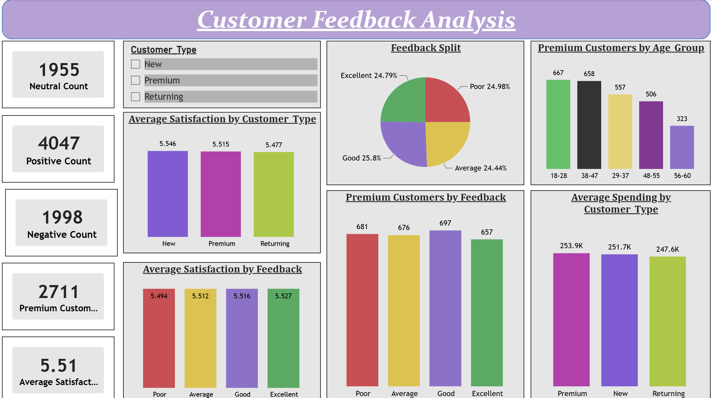
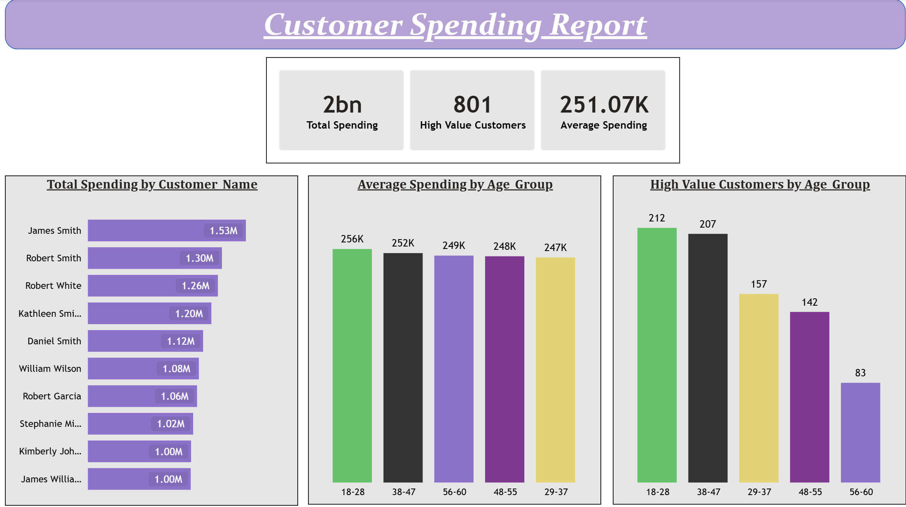
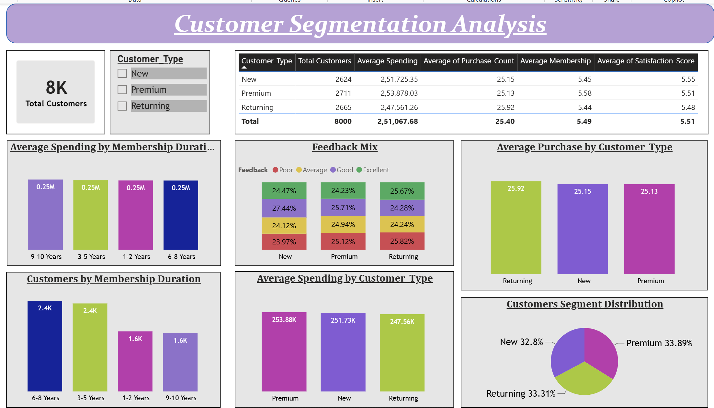
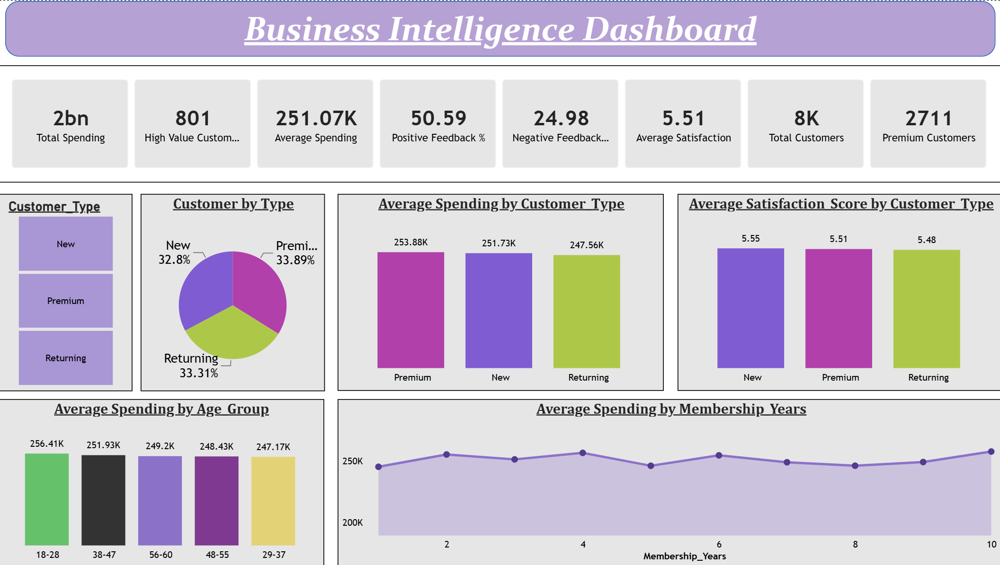

# Customer Data Analytics

## Problem Statement

This project focuses on analyzing customer data of a business with 8,000 customer records to understand customer feedback, spending behaviour, segmentation and membership patterns.

Using Power BI, interactive dashboards are developed to analyze:

- **Customer Feedback Analysis:** Positive, negative and neutral feedback, average satisfaction and feedback distribution.
- **Customer Spending Analysis:** Top 10 spending customers, total spending, average customer spending and age-group spending patterns.
- **Customer Segmentation:** Comparison of New, Returning and Premium customers based on spending, average number of purchases, satisfaction and membership duration.
- **Business Intelligence Dashboard:** Consolidated customer insights through key performance indicators (KPIs), interactive filters and visual comparisons.

**Output:** Interactive Power BI dashboards with KPI cards, slicers, pie charts, bar charts, column charts, line charts and comparative tables.

### Level 1 – Task 2: Customer Feedback Analysis

#### Objective

Analyze customer satisfaction and feedback trends using the `customer_analytics_dataset`.

**Requirements:**
- Count positive and negative feedback.
- Calculate average satisfaction score.
- Analyze Premium customers.
- Create pie charts and bar graphs.

### Steps Followed

- Step 1 : Opened Power BI Desktop and selected **Get Data → Excel Workbook** to import the `customer_analytics_dataset`.

- Step 2 : Selected the required dataset and opened it in Power Query Editor using the **Transform Data** option.

- Step 3 : Inspected the dataset using the Column Quality, Column Distribution, and Column Profile options to examine the quality and distribution of the available columns.

  The dataset was reviewed for missing values, errors, and other potential data quality issues. The data appeared suitable for analysis, and no additional data transformation was required at this stage.

- Step 4 : Selected **Close & Apply** to load the data into Power BI Desktop.

- Step 5 : In the Data pane, renamed the imported table to **Customer** for easier identification and reference while creating calculated columns and DAX measures.

- Step 6 : Created a new report page and inserted a shape to display the heading **Customer Feedback Analysis**. The shape was formatted using the required background colour, font style, alignment, and text formatting.

- Step 7 : Created a conditional column named `Feedback_Group` to classify customer feedback into three categories: Positive, Negative, and Neutral.

  The following classification was used:

  | Feedback | Feedback Group |
  |---|---|
  | Excellent | Positive |
  | Good | Positive |
  | Average | Neutral |
  | Poor | Negative |

  This classification helps analyse positive, negative, and neutral customer feedback separately.

- Step 8 : Created a `Feedback_Order` column to establish a logical sorting sequence for the Feedback categories.

  The following numerical values were assigned:

  | Feedback | Feedback Order |
  |---|---|
  | Poor | 1 |
  | Average | 2 |
  | Good | 3 |
  | Excellent | 4 |

  The **Sort by Column** option was used to sort the Feedback column using Feedback_Order instead of the default alphabetical order.

- Step 9 : Created a new measure named `Total Customers` to calculate the total number of customer records using the COUNTROWS function.

  Following DAX expression was written:

        Total Customers = COUNTROWS(Customer)

- Step 10 : Created a new measure named `Positive Count` to calculate the number of customers providing positive feedback.

  The CALCULATE function was used to evaluate the Total Customers measure under the filter condition where Feedback_Group is Positive.

  Following DAX expression was written:

        Positive Count =
        CALCULATE(
            [Total Customers],
            Customer[Feedback_Group] = "Positive"
        )

- Step 11 : Created a new measure named `Negative Count` to calculate the number of customers providing negative feedback.

  The CALCULATE function was used to filter the Customer table for records where Feedback_Group is Negative.

  Following DAX expression was written:

        Negative Count =
        CALCULATE(
            [Total Customers],
            Customer[Feedback_Group] = "Negative"
        )

- Step 12 : Created a new measure named `Neutral Count` to calculate the number of customers providing neutral feedback.

  Following DAX expression was written:

        Neutral Count =
        CALCULATE(
            [Total Customers],
            Customer[Feedback_Group] = "Neutral"
        )

- Step 13 : Created measures named `Positive %` and `Negative %` to calculate the percentage of customers providing positive and negative feedback, respectively.

  The DIVIDE function was used to calculate the percentage by dividing the respective feedback count by Total Customers and multiplying the result by 100.

  Following DAX expressions were written:

        Positive % =
        DIVIDE([Positive Count], [Total Customers]) * 100

        Negative % =
        DIVIDE([Negative Count], [Total Customers]) * 100

- Step 14 : Created a new measure named `Average Satisfaction` to calculate the average customer satisfaction score using the AVERAGE function.

  Following DAX expression was written:

        Average Satisfaction =
        AVERAGE(Customer[Satisfaction_Score])

- Step 15 : Created a new measure named `Premium Customers` to calculate the total number of customers belonging to the Premium customer category.

  The CALCULATE function was used with the Customer_Type filter set to Premium.

  Following DAX expression was written:

        Premium Customers =
        CALCULATE(
            [Total Customers],
            Customer[Customer_Type] = "Premium"
        )

- Step 16 : Created five Card visuals to display the following key performance indicators (KPIs):

  - Positive Count
  - Negative Count
  - Neutral Count
  - Premium Customers
  - Average Satisfaction

  These cards provide a quick overview of customer feedback and satisfaction.

- Step 17 : Created a Pie Chart named **Feedback Split** to analyse the distribution of customers across the four feedback categories.

  The following fields were added:

  - Legend: Feedback
  - Values: Total Customers

  The Detail Labels option was configured to display the Feedback category and Percentage of Total.

  This visualization helps understand the proportion of customers providing Poor, Average, Good, and Excellent feedback.

- Step 18 : Created a Clustered Column Chart named **Average Satisfaction by Feedback** to compare the average satisfaction score across the four feedback categories.

  The following fields were added:

  - X-axis: Feedback
  - Y-axis: Average Satisfaction

  This visualization helps compare the numerical satisfaction scores with the corresponding categorical feedback.

- Step 19 : Created a Clustered Column Chart named **Average Satisfaction by Customer Type** to compare the average satisfaction scores of New, Premium, and Returning customers.

  The following fields were added:

  - X-axis: Customer_Type
  - Y-axis: Average Satisfaction

  This visualization helps identify differences in satisfaction levels across customer segments.

- Step 20 : Created a new measure named `Average Spending` to calculate the average spending of customers.

  Following DAX expression was written:

        Average Spending =
        AVERAGE(Customer[Total_Spending])

- Step 21 : Created a Clustered Column Chart named **Average Spending by Customer Type** to compare the average spending across different customer categories.

  The following fields were added:

  - X-axis: Customer_Type
  - Y-axis: Average Spending

  This visualization helps compare the spending behaviour of New, Premium, and Returning customers.

- Step 22 : Created a Clustered Column Chart named **Premium Customers by Feedback** to analyse the distribution of feedback among Premium customers.

  The following fields were added:

  - X-axis: Feedback
  - Y-axis: Total Customers

  A visual-level filter was applied to Customer_Type, selecting only Premium customers.

  This visualization helps identify how Premium customers rate their experience across the four feedback categories.

- Step 23 : Created a Clustered Column Chart named **Premium Customers by Age Group** to analyse the distribution of Premium customers across different age categories.

  The following fields were added:

  - X-axis: Age Group
  - Y-axis: Total Customers

  A visual-level filter was applied to Customer_Type, selecting only Premium customers.

  This visualization helps identify the age groups contributing to the Premium customer segment.

- Step 24 : Added a Slicer using the Customer_Type field to enable interactive filtering of the report.

  The slicer allows users to select New, Premium, or Returning customers and analyse the corresponding customer feedback and satisfaction metrics.

- Step 25 : Used the **Edit Interactions** feature to control the interaction between the Customer_Type slicer and the report visuals.

  The interaction was disabled for the Premium Customers by Feedback and Premium Customers by Age Group charts.

  This ensures that these two charts continue to display Premium customer data even when another customer type is selected in the slicer.

  The remaining visuals were configured to respond to the Customer_Type slicer.

### Customer Feedback Analysis

The Customer Feedback Analysis page looks like this:

### Level 1 – Task 3: High-Value Customer Analysis

#### Objective

Identify high-value customers based on their spending behaviour.

**Requirements:**
- Find top spending customers.
- Calculate average customer spending.
- Perform age-group spending analysis.
- Create a simple dashboard.

### Steps Followed

- Step 1 : Created a new report page and inserted a shape to display the heading **Customer Spending Report**. The shape was formatted using the required background colour, font style, alignment, and text formatting.

- Step 2 : Created a conditional column named `Age Group` in Power Query to categorize customers based on their age.

  The age range of 18 to 60 was divided into five groups:

  | Age Group | Age Range |
  |---|---|
  | 18–28 | 18 to 28 |
  | 29–37 | 29 to 37 |
  | 38–47 | 38 to 47 |
  | 48–55 | 48 to 55 |
  | 56–60 | 56 to 60 |

  This categorization helps analyse customer spending patterns across different age groups.

- Step 3 : Created another conditional column named `Customer_Level` in Power Query to classify customers based on their total spending.

  The following condition was applied:

  - If Total_Spending is greater than or equal to 449000, the customer is classified as **High-Value**.
  - Otherwise, the customer is classified as **Regular**.

  This classification helps identify customers with higher spending contributions and enables further analysis of the High-Value customer segment.

- Step 4 : Created a new measure named `Total Spending` to calculate the combined spending of all customers using the SUM function.

  Following DAX expression was written:

        Total Spending =
        SUM(Customer[Total_Spending])

- Step 5 : Created a new measure named `Average Spending` to calculate the average spending per customer using the AVERAGE function.

  Following DAX expression was written:

        Average Spending =
        AVERAGE(Customer[Total_Spending])

  This measure helps understand the average spending behaviour of customers.

- Step 6 : Created a new measure named `High Value Customers` to calculate the total number of customers classified as High-Value.

  The CALCULATE function was used with the Customer_Level filter set to High-Value.

  Following DAX expression was written:

        High Value Customers =
        CALCULATE(
            [Total Customers],
            Customer[Customer_Level] = "High-Value"
        )

  The existing Total Customers measure from the previous task was reused to calculate the number of High-Value customers.

- Step 7 : Created three Card visuals to display the following key performance indicators (KPIs):

  - Total Spending
  - High Value Customers
  - Average Spending

  These cards provide an overview of the overall customer spending, the number of High-Value customers, and the average spending per customer.

- Step 8 : Created a Bar Chart named **Total Spending by Customer Name** to identify the top 10 customers based on their total spending.

  The following fields were added:

  - Y-axis: Customer_Name
  - X-axis: Total Spending

  A Top N visual-level filter was applied to the Customer_Name field. The filter was configured to display the top 10 customers based on the Total Spending measure.

  This visualization helps identify the customers contributing the highest spending.

  Snap of the Bar Chart:

- Step 9 : Created a Stacked Column Chart named **Average Spending by Age Group** to analyse the average customer spending across different age groups.

  The following fields were added:

  - X-axis: Age Group
  - Y-axis: Average Spending

  The chart was sorted in descending order based on Average Spending to display the age groups with higher average spending first.

  This visualization helps compare the spending behaviour of different age segments and identify the age group with the highest average spending.

- Step 10 : Created a Column Chart named **High Value Customers by Age Group** to analyse the distribution of High-Value customers across different age groups.

  The following fields were added:

  - X-axis: Age Group
  - Y-axis: High Value Customers

  This visualization helps identify the age groups containing the highest number of High-Value customers.

### Customer Spending Report

The Customer Spending Report page looks like this:

### Level 2 – Task 2: Customer Segmentation Analysis

#### Objective

Segment customers into different categories and analyse their spending behaviour, purchase patterns, and membership duration.

**Requirements:**
- Segment customers into different categories.
- Analyse New vs Returning vs Premium customers.
- Study spending behaviour.
- Analyse membership duration.
- Build a visual dashboard.

### Steps Followed

- Step 1 : Created a new report page and inserted a shape to display the heading **Customer Segmentation Analysis**. The shape was formatted using the required background colour, font style, alignment, and text formatting.

- Step 2 : Created a conditional column named `Membership Duration` in Power Query to categorize customers based on their membership years.

  The following conditions were applied:

  | Condition | Membership Duration |
  |---|---|
  | Membership_Years <= 2 | 1–2 Years |
  | Membership_Years <= 5 | 3–5 Years |
  | Membership_Years <= 8 | 6–8 Years |
  | Otherwise | 9–10 Years |

  This categorization helps analyse customer spending and distribution across different membership duration groups.

- Step 3 : Created a Custom Column named `Spend per Purchase` in Power Query to calculate the spending per purchase.

  The calculation was based on dividing Total_Spending by Purchase_Count.

  This column helps understand the amount spent by customers per purchase rather than considering only their overall spending.

- Step 4 : Created a new measure named `Total Customers` to calculate the total number of customer records using the COUNTROWS function.

  Following DAX expression was written:

        Total Customers =
        COUNTROWS(Customer)

- Step 5 : Created a new measure named `Average Membership` to calculate the average membership duration of customers using the AVERAGE function.

  Following DAX expression was written:

        Average Membership =
        AVERAGE(Customer[Membership_Years])

  This measure helps compare the average membership duration across New, Premium, and Returning customers.

- Step 6 : Created a Slicer using the `Customer_Type` field to enable interactive filtering of the report.

  The slicer contains three customer categories:

  - New
  - Premium
  - Returning

  This allows the report to be filtered according to the selected customer segment.

- Step 7 : Created a Table Visual to provide a comparative overview of different customer segments.

  The following fields and aggregations were used:

  | Field | Aggregation |
  |---|---|
  | Customer_Type | Category |
  | Total Customers | Count |
  | Total_Spending | Average |
  | Purchase_Count | Average |
  | Membership_Years | Average |
  | Satisfaction_Score | Average |

  The table helps compare the number of customers, average spending, purchase frequency, average membership duration, and average satisfaction score across different customer categories.

- Step 8 : Created a Pie Chart named **Customers Segment Distribution** to represent the distribution of customers across different customer categories.

  The following fields were added:

  - Legend: Customer_Type
  - Values: Total Customers

  The chart displays the percentage contribution of New, Premium, and Returning customers to the overall customer population.

  This visualization helps understand the distribution of customers across the three segments.

- Step 9 : Created a 100% Stacked Column Chart named **Feedback Mix** to analyse the feedback distribution across different customer categories.

  The following fields were added:

  - X-axis: Customer_Type
  - Y-axis: Total Customers
  - Legend: Feedback

  The chart represents the percentage distribution of Poor, Average, Good, and Excellent feedback within each customer category.

  This visualization helps compare customer feedback patterns across New, Premium, and Returning customers.

- Step 10 : Created a Clustered Column Chart named **Average Spending by Customer Type** to compare the average spending across different customer categories.

  The following fields were added:

  - X-axis: Customer_Type
  - Y-axis: Average Spending

  The existing Average Spending measure was used to calculate the average spending for each customer segment.

  This visualization helps identify which customer category has the highest average spending.

- Step 11 : Created a Clustered Column Chart named **Average Purchase by Customer Type** to compare the average purchase count across different customer categories.

  The following fields were added:

  - X-axis: Customer_Type
  - Y-axis: Average of Purchase_Count

  The aggregation of Purchase_Count was set to Average.

  This visualization helps compare the average number of purchases made by New, Premium, and Returning customers.

- Step 12 : Created a Column Chart named **Average Spending by Membership Duration** to analyse the average spending across different membership duration groups.

  The following fields were added:

  - X-axis: Membership Duration
  - Y-axis: Average Spending

  The chart was sorted in descending order based on Average Spending to display the membership groups with higher average spending first.

  This visualization helps understand the relationship between membership duration and customer spending behaviour.

- Step 13 : Created a Column Chart named **Customers by Membership Duration** to analyse the distribution of customers across different membership duration groups.

  The following fields were added:

  - X-axis: Membership Duration
  - Y-axis: Total Customers

  This visualization helps identify the membership duration categories containing the highest number of customers.

### Customer Segmentation Analysis

The Customer Segmentation Analysis page looks like this:

### Level 3 – Task 3: Business Intelligence Dashboard

#### Objective

Build a comprehensive Business Intelligence Dashboard to provide an overall view of customer-related business performance and generate meaningful insights from the available dataset.

**Requirements:**
- Include Customer Insights.
- Implement Interactive Filters and Charts.
- Build a Business Intelligence Dashboard.

### Steps Followed

- Step 1 : Created a new report page and inserted a shape to display the heading **Business Intelligence Dashboard**. The shape was formatted using the required background colour, font style, alignment, and text formatting.

- Step 2 : Created eight Card visuals to display the following key performance indicators (KPIs):

  - Total Spending
  - High Value Customers
  - Average Spending
  - Positive Feedback %
  - Negative Feedback %
  - Average Satisfaction
  - Total Customers
  - Premium Customers

  These cards provide an overview of customer spending, customer segmentation, feedback distribution, and satisfaction levels.

- Step 3 : Created a Pie Chart named **Customer by Type**.

  - Legend: Customer_Type
  - Values: Total Customers

  This visualization displays the percentage distribution of New, Premium, and Returning customers.

- Step 4 : Created a Clustered Column Chart named **Average Spending by Customer Type**.

  - X-axis: Customer_Type
  - Y-axis: Average Spending

  This visualization compares average spending across different customer categories.

- Step 5 : Created a Clustered Column Chart named **Average Satisfaction Score by Customer Type**.

  - X-axis: Customer_Type
  - Y-axis: Average Satisfaction

  This visualization compares customer satisfaction across New, Premium, and Returning customers.

- Step 6 : Created a Column Chart named **Average Spending by Age Group**.

  - X-axis: Age_Group
  - Y-axis: Average Spending

  The chart was sorted in descending order based on Average Spending.

  This visualization helps identify the age group with the highest average customer spending.

- Step 7 : Created a Line Chart named **Average Spending by Membership Years**.

  - X-axis: Membership_Years
  - Y-axis: Average Spending

  This visualization helps examine spending patterns across different membership years.

- Step 8 : Added a Slicer using the `Customer_Type` field to enable interactive filtering of the dashboard.

  The slicer contains three customer categories:

  - New
  - Premium
  - Returning

  This allows users to select a particular customer segment.

- Step 9 : Used the **Edit Interactions** feature to configure the interaction between the Customer_Type slicer and the dashboard charts.

  All charts were connected to the slicer to enable dynamic filtering of the visualizations.

### Business Intelligence Dashboard

The final Business Intelligence Dashboard looks like this:

## Insights

- The dashboard covers **8,000 customers**, with total customer spending displayed as approximately **2 billion**.

- Customer segmentation shows that **Premium customers account for 33.89%**, Returning customers for **33.31%**, and New customers for **32.8%** of the total customer base.

- Average spending is highest among **Premium customers at 253.88K**, followed by New customers at **251.73K** and Returning customers at **247.56K**.

- Average satisfaction is highest among **New customers at 5.55**, followed by Premium customers at **5.51** and Returning customers at **5.48**.

- The **18–28 age group** has the highest average spending at **256.41K**, while the **29–37 age group** has the lowest at **247.17K**.

- The remaining age groups show average spending of **251.93K for ages 38–47**, **249.20K for ages 56–60**, and **248.43K for ages 48–55**.

- The dashboard identifies **801 High-Value Customers** and **2,711 Premium Customers**.

- Positive feedback accounts for **50.59%**, while negative feedback accounts for **24.98%** of customer feedback. The overall average satisfaction score is **5.51**.

- Average spending across membership years shows some fluctuations, as represented by the line chart.

**Abhishek Kumar**  
Github:  [https://github.com/vk18abhishek]

